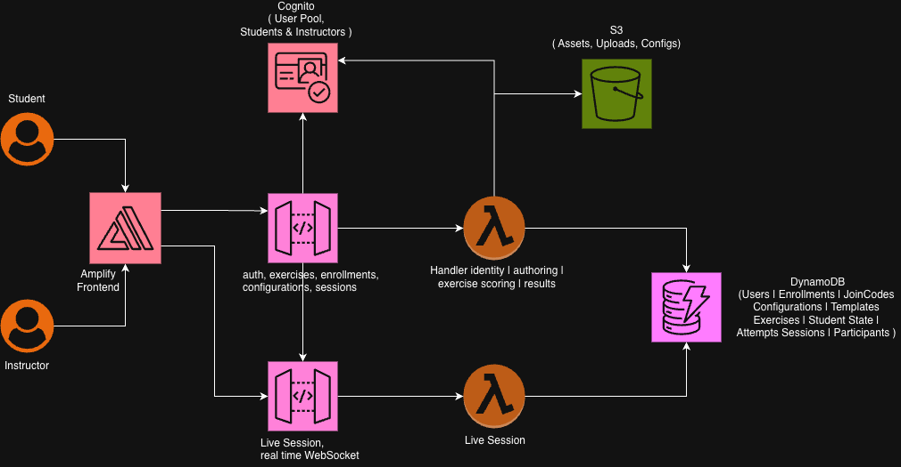

# Development Process Navigator

> An educational web application for ASU W.P. Carey's MRED program — instructors pick one of five development scenarios, students work through a five-round card sort (process stages, major activities, professionals, tasks/deliverables, and developer decisions) plus a budget/schedule step, with weighted scoring, per-round feedback, and a one-time correct-and-resubmit flow.

**Live App:** https://main.dpg1ppd4e998.amplifyapp.com  

**Project Demo Recording** - https://drive.google.com/file/d/1eDLCrONHJzUO03uNjQVqwqMlDjwaaliU/view?usp=drive_link

---

## Quick Links

| Document | Description |
|---|---|
| [User Guide](docs/userGuide.md) | Step-by-step guide for instructors and students |
| [Deployment Guide](docs/deploymentGuide.md) | One-command and manual deployment, updates, troubleshooting |
| [API Documentation](docs/APIDoc.md) | Every REST endpoint with request and response shapes |
| [Architecture Deep Dive](docs/architectureDeepDive.md) | Request flow, services, security, design decisions |
| [Modification Guide](docs/modificationGuide.md) | Where and how to change or extend the app |
| [Project Closure](docs/projectClosure.md) | Scope, delivery, challenges, and future work |

Earlier documents (`docs/DEPLOYMENT.md`, `docs/ARCHITECTURE.md`, `docs/USER-GUIDE.md`) are kept for reference. The guides above replace them.

---

## What It Does

| Role | Capabilities |
|---|---|
| **Instructor** | Create exercises (drag activities into phase mappings with weights), manage student roster via email invite or join code, view class results and history |
| **Student** | Complete drag-and-drop activity sorting exercises, receive per-card scored feedback, view attempt history and scores |

---

## Architecture

<p align="center">
  
</p>

```
┌─────────────────────────────────────────────┐
│           AWS Amplify Hosting                │
│         Next.js 14 Static Export            │
│    (Instructor UI + Student UI + Tutorial)   │
└────────────────────┬────────────────────────┘
                     │ HTTPS
                     │
          ┌──────────▼──────────┐
          │    REST API         │
          │    Gateway          │
          │   (Cognito          │
          │   Authorizer)       │
          └──────────┬──────────┘
                     │
          ┌──────────▼──────────┐
          │      Lambda         │
          │   (REST API)        │
          │   Python 3.12       │
          └──────────┬──────────┘
                     │
   ┌─────────────────┼──────────────────┐
   │                 │                  │
┌──▼───────┐  ┌──────▼──────┐  ┌───────▼───┐
│ DynamoDB │  │   Cognito   │  │    S3     │
│(12 tables)│  │  User Pool  │  │  Assets   │
└──────────┘  └─────────────┘  └───────────┘
```

| Layer | Technology |
|---|---|
| Frontend | Next.js 14 (React/TypeScript), AWS Amplify Hosting |
| Backend | Python 3.12 Lambda, modular monolith |
| REST API | Amazon API Gateway (REST) + Cognito authorizer |
| Data | Amazon DynamoDB — 12 tables, on-demand |
| Auth | Amazon Cognito User Pool (Instructor / Student groups) |
| Storage | Amazon S3 (asset uploads) |
| IaC | AWS CDK v2 (TypeScript, single stack) |

---

## Repository Layout

```
├── frontend/                   Next.js SPA
│   ├── app/
│   │   ├── page.tsx            Login / Register
│   │   ├── layout.tsx          Root layout (NavBar + footer)
│   │   ├── instructor/         Dashboard, Exercises, Roster, Results
│   │   ├── student/            Dashboard, Exercise board, History, Scores
│   │   └── tutorial/           Help Center (role-tabbed guides)
│   ├── src/shared/             NavBar, Sidebars, InfoIcon, apiClient, session
│   └── deploy_amplify.sh       Manual Amplify deploy script
│
├── backend/                    Python modular monolith
│   ├── src/
│   │   ├── api/                Lambda handler + dispatcher + router
│   │   ├── identity/           U1 — Auth & access
│   │   ├── authoring/          U2 — Exercise authoring
│   │   ├── exercise/scoring/   U3 — Pure scoring engine
│   │   ├── results/            U4 — History & results
│   │   └── live_session/       U5 — WebSocket live session
│   ├── tests/                  22 unit tests (all passing)
│   └── scripts/                smoke_test.sh, probe.sh
│
├── infrastructure/             AWS CDK (TypeScript)
│   ├── lib/processcanvas-stack.ts  Single stack — all resources
│   └── bin/processcanvas.ts
│
├── docs/                       Documentation
│   ├── DEPLOYMENT.md           Full deployment guide
│   ├── ARCHITECTURE.md         Architecture & design
│   └── USER-GUIDE.md           Instructor & student guides
│
├── deploy.sh                   One-click full deployment script
└── README.md                   This file
```

---

## One-Click Deployment (CloudShell)

Open **AWS CloudShell** in your target account and run:

```bash
git clone https://github.com/ASUCICREPO/Development-Process-Navigator.git
cd Development-Process-Navigator
chmod +x deploy.sh
./deploy.sh
```

That's it. The script installs all dependencies, deploys the CDK stack (backend + all AWS resources), builds the frontend, and deploys it to Amplify. See [`docs/DEPLOYMENT.md`](docs/DEPLOYMENT.md) for full details.

---

## Local Development

### Prerequisites
- Node.js 18+ and npm
- Python 3.12+
- AWS CLI + CDK CLI (`npm install -g aws-cdk`)

### Frontend
```bash
cd frontend
npm install
npm run dev          # http://localhost:3000
```

### Backend tests
```bash
cd backend
pip install -r requirements.txt
pytest -q            # 22 tests, all pass
```

### Infrastructure
```bash
cd infrastructure
npm install
export INSTRUCTOR_ACCESS_CODE=<your-code>   # required; never commit it
cdk synth            # validate (no deploy)
cdk deploy --profile <your-profile>
```

---

## DynamoDB Tables

| Table | Partition Key | Sort Key | Purpose |
|---|---|---|---|
| Users | userId | — | User profiles |
| Enrollments | instructorId | studentId | Class enrollment |
| JoinCodes | code | — | Self-enrollment codes |
| Configurations | configId | — | Exercise configurations |
| ConfigurationVersions | configId | versionNumber | Config versioning |
| Templates | templateId | — | Reusable templates |
| Exercises | exerciseId | — | Published exercises |
| StudentExerciseState | exerciseId | studentId | Student progress / drafts |
| Attempts | studentId | attemptId | Submission history |
| Sessions | sessionId | — | Live session records |
| SessionParticipants | sessionId | studentId | Live session roster |
| WsConnections | sessionId | connectionId | Active WebSocket connections |

---

## Instructor Access Code

Instructors register with a private access code to prevent unauthorized accounts.  
The code is **not stored in the repository**. It is supplied at deploy time and set as the Lambda environment variable `INSTRUCTOR_ACCESS_CODE`. Deployment stops if it is missing, and the backend has no default.

**To set or rotate:**
1. Run `INSTRUCTOR_ACCESS_CODE=<new-code> AWS_PROFILE=<your-profile> ./deploy.sh` (or `cdk deploy --context instructorAccessCode=<new-code>` from `infrastructure/`)
2. Share the new code privately with faculty

---

## Credits

This application was developed by :
- <a href="https://www.linkedin.com/in/sreeram-s-5454961aa/" target="_blank">Sreeram Saravana Prasad</a>
- <a href="https://www.linkedin.com/in/shakthiarun22/" target="_blank">Lahari Shakthi Arun</a>

## License

Arizona State University · W.P. Carey School of Business · ASU AI Cloud Innovation Center
