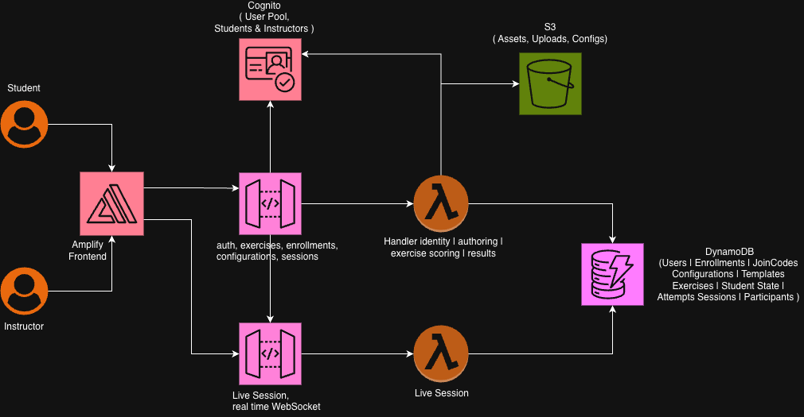

# Architecture Deep Dive

This document explains how Development Process Navigator is built. Internally the project is called "ProcessCanvas", so that name appears in stack, table, and function names.

---

## Architecture Diagram



Everything is serverless and lives in one AWS CDK stack, `ProcessCanvasStack`:

- **Frontend**: a static Next.js export hosted on AWS Amplify.
- **API**: one REST API in API Gateway, checked by a Cognito authorizer, in front of a single Python Lambda.
- **Data**: twelve DynamoDB tables.

Nothing runs on a server that's always on.

---

## Architecture Flow

### 1. User Interaction
A student or instructor opens the Amplify-hosted site and signs in. The site is a static export, so every page is plain HTML and JavaScript served from Amplify's CDN.

Students drag cards on the round board (`frontend/src/student/RoundsBoard.tsx`). Instructors pick and customize a scenario (`frontend/src/instructor/ScenarioCustomizer.tsx`).

### 2. Request Processing
- **Sign-in**: the browser sends `POST /auth/login`. The Lambda calls Cognito `InitiateAuth` and returns an `idToken`.
- **Saving the session**: the browser stores the token, role, and user ID in `localStorage` (`pc_idToken`, `pc_role`, `pc_userId`).
- **Later requests**: these go to API Gateway with `Authorization: Bearer <idToken>`. The Cognito User Pool authorizer checks the token before the Lambda runs, and bad tokens get a `401` without reaching it.

### 3. Routing and Authorization
- **Entry point**: API Gateway passes every request to the `ApiFn` Lambda through a proxy integration. The handler is `src.api.lambda_handler.handler`.
- **Identity**: the handler builds a `Principal` (user ID and role) from the authorizer's claims, then hands the request to `dispatch()` in `backend/src/api/app.py`.
- **Checks in the domain functions**: each one checks the role (`_require_role`) and ownership. For example, instructors can only see exercises they own, and students can only see their own attempts.

### 4. Scoring
Scoring is pure Python with no I/O (`backend/src/exercise/rounds.py` and `exercise/scoring/scoring.py`). Each round is scored on its own, then the rounds are combined with each round weighted by its denominator, so every card counts once.

- **Match rounds (r2–r5)**: each card earns the sum of the weights of the targets it was placed on, capped at its best single weight. Extra placements cost nothing. Each placement is labeled Correct (the card's best target), Partial (another target with weight), or Incorrect (no weight).
- **Sequence round (r1)**: credit depends on how far each stage is from its correct position.
- **Weakest match**: the placement with the biggest gap, used for the reflection prompt.

The client never receives the weights. The board response leaves out `mappings`.

### 5. Response Generation
The Lambda saves the attempt (`Attempts`) and the student's state (`StudentExerciseState`: attempt count and lock flag), then returns JSON. The browser shows a results screen with a score breakdown per round. The second submission locks the exercise.

---

## Cloud Services / Technology Stack

### Frontend
- **Next.js 14**: a React and TypeScript app that only runs in the browser (no server-side rendering), exported statically to `frontend/out/`.
  - App Router for page routing (`frontend/app/`).
  - Shared pieces in `frontend/src/shared/`: `apiClient`, session helpers, `useRoleGuard`, the sidebars, and `InfoIcon`.
  - Inline styles plus `app/globals.css`, using ASU maroon (`#8C1D40`) and gold (`#FFC627`).
- **AWS Amplify Hosting**: serves the static site at `https://main.<appId>.amplifyapp.com`. The app has **no Git repository connected**; deploys are zip uploads (see the [Deployment Guide](./deploymentGuide.md)).

### Backend Infrastructure
- **AWS CDK v2 (TypeScript)**: one stack in `infrastructure/lib/processcanvas-stack.ts`.
  - Defines every resource, IAM grants, and outputs.
  - Gives reproducible deploys from `deploy.sh`.

- **Amazon API Gateway (REST)**: the front door for every application request.
  - `prod` stage, CORS for all origins, INFO-level execution logging.
  - Two public routes: `POST /auth/register` and `POST /auth/login`. Everything else goes through `/{proxy+}` (`ANY`) with the Cognito authorizer.
  - Gateway error responses (`401`, `403`, `4XX`, `5XX`) include CORS headers, so the browser shows real auth errors instead of misleading CORS errors.

- **Amazon API Gateway (WebSocket)**: a `prod` stage meant for live session progress. It's deployed, but the feature isn't finished (see [Known Gaps](#known-gaps)).

- **AWS Lambda** (Python 3.12, 128 MB, 29 s timeout):
  - **ApiFn**: handles every REST route as a modular monolith with these packages:
    - `identity`: auth, roster, and join codes
    - `authoring`: templates, taxonomy, and seed scenarios
    - `exercise`: rounds and scoring
    - `results`: history and class results
  - **WsFn**: handles the WebSocket `$connect`, `$disconnect`, and `$default` routes. It's configured with handler `src.live_session.ws_handler.handler`, which isn't in the repo yet.
  - **S3 auto-delete custom resource**: created by CDK to empty the asset bucket when the stack is destroyed.

### AI/ML Services
None. Scoring is rule-based and deterministic, driven by the weight matrix from the Instructor Manual (`backend/src/authoring/taxonomy.py`). No Amazon Bedrock or other ML service is used.

### Data Storage
- **Amazon DynamoDB**: twelve on-demand (`PAY_PER_REQUEST`) tables.

  | Table | PK | SK | GSI | Purpose |
  |---|---|---|---|---|
  | Users | userId | — | byEmail | Profiles (name, email, role) |
  | Enrollments | instructorId | studentId | byStudent | Class roster, including `pending:<email>` invites |
  | JoinCodes | code | — | — | Self-enrollment codes |
  | Configurations | configId | — | byOwner | Draft scenario configurations |
  | ConfigurationVersions | configId | versionNumber | — | Frozen snapshots behind published exercises |
  | Templates | templateId | — | byOwner | Five built-in scenarios plus instructor templates |
  | Exercises | exerciseId | — | — | Published exercises (configId + versionId) |
  | StudentExerciseState | exerciseId | studentId | — | Draft placements, budget/schedule, attempt count, lock |
  | Attempts | studentId | attemptId | byExercise | Scored submissions and round results |
  | Sessions | sessionId | — | — | Live session records (not used yet) |
  | SessionParticipants | sessionId | studentId | — | Live session roster (not used yet) |
  | WsConnections | sessionId | connectionId | byConnection | WebSocket connections (not used yet) |

- **Amazon S3**: a private asset bucket (all public access blocked, S3-managed encryption, CORS for GET/PUT/POST). The Lambda has read/write access, but **the current backend doesn't read or write it**. It's reserved for future uploads.

### Additional Services
- **Amazon Cognito**: User Pool with self sign-up, email as the username, and an unchangeable `custom:role` attribute. It has `Instructors` and `Students` groups. Users are created through `AdminCreateUser` with email verification turned off.
- **Amazon SES**: a domain identity (`sesEmailDomain` context, default `wpcarey.asu.edu`) for roster invite emails. Instructors' addresses also get verification requests when they register. Emails only send once the domain's DKIM records are in DNS.
- **Amazon CloudWatch Logs**: `/processcanvas/lambda/api` and `/processcanvas/lambda/websocket`, kept for one month.

---

## Infrastructure as Code

This project uses **AWS CDK (Cloud Development Kit)** to define and deploy its infrastructure.

### CDK Stack Structure

```
infrastructure/
├── bin/
│   └── processcanvas.ts        # CDK app entry point
├── lib/
│   └── processcanvas-stack.ts  # The single ProcessCanvasStack
└── cdk.json                    # Runs bin/processcanvas.ts via ts-node
backend/                        # Lambda asset (packaged as-is)
└── src/
    ├── api/                    # lambda_handler.py, app.py (dispatch), router.py
    ├── identity/  authoring/  exercise/  results/  live_session/  shared/
```

### Key CDK Constructs

Every resource is defined directly with `aws-cdk-lib` constructs, plus `@aws-cdk/aws-amplify-alpha` for hosting.

1. **`cognito.UserPool` + `addClient("WebClient")`**: auth with the `USER_PASSWORD_AUTH` and SRP flows, an unchangeable `custom:role`, and a password policy (8+ characters, a digit, and a lowercase letter).
2. **`dynamodb.Table` ×12**: built by a small `table(name, pk, sk?)` helper with on-demand billing and `RemovalPolicy.DESTROY`. Table names reach the Lambda as `TABLE_<NAME>` environment variables.
3. **`lambda.Function` (ApiFn, WsFn)**: `Code.fromAsset("../backend")`, so `backend/` is the package root and imports look like `src.api...`.
4. **`apigw.RestApi` + `CognitoUserPoolsAuthorizer`**: the public auth routes plus an authorized `{proxy+}` route, with CORS-aware `GatewayResponse`s.
5. **`apigwv2.WebSocketApi` + `WebSocketStage`**: live session transport. WsFn may call `execute-api:ManageConnections`.
6. **`amplify.App` + `addBranch("main")`**: hosting, with the build environment variables (`NEXT_PUBLIC_API_URL` and others).
7. **`ses.EmailIdentity`**: the invite email domain.
8. **`CfnOutput`s**: `RestApiUrl`, `WsApiUrl`, `UserPoolId`, `UserPoolClientId`, `AssetBucketName`, `AmplifyAppId`, `AmplifyDefaultDomain`, `AmplifyBranchUrl`, and `SesEmailDomain`.

### Configuration Supplied at Deploy Time
- **Instructor access code**: required and never committed. Pass it with `--context instructorAccessCode=<code>` or the `INSTRUCTOR_ACCESS_CODE` environment variable. Synth fails if it's missing.
- **`sesEmailDomain`**: optional context; the default is `wpcarey.asu.edu`.

### Deployment Automation
There's no CI/CD pipeline. `deploy.sh` does a full deploy from a laptop or AWS CloudShell:
1. Checks prerequisites and reads the access code.
2. Bootstraps CDK and deploys the stack.
3. Sets `APP_URL` on the Lambda for invite links.
4. Builds the frontend with the stack outputs baked in.
5. Uploads the build to Amplify and waits for it to finish.

Frontend-only and backend-only redeploys are covered in the [Deployment Guide](./deploymentGuide.md).

---

## Security Considerations

- **Authentication**: Cognito User Pool JWTs. API Gateway checks the `idToken` on every route except register and login. Logins go through the Lambda (`InitiateAuth`), so the frontend never talks to Cognito directly.
- **Authorization**:
  - **Role**: the `custom:role` claim can't be changed after sign-up. `_require_role` blocks instructor-only routes.
  - **Ownership**: checked for every exercise, configuration, roster, and results call. Students can only read their own history and attempts.
  - **Instructor sign-up**: needs the access code supplied at deploy time. It's compared in constant time (`hmac.compare_digest`), and sign-up is refused if no code is configured.
- **Data encryption**:
  - **In transit**: HTTPS and WSS everywhere.
  - **At rest**: DynamoDB uses its default AWS-owned key encryption; S3 uses S3-managed keys (SSE-S3).
- **Network security**: the S3 bucket blocks all public access. DynamoDB is only reachable through IAM; the Lambda role gets read/write on exactly the stack's tables. Cognito admin permissions are limited to this User Pool.
- **Answer protection**: scoring weights stay on the server. The board API leaves out `mappings`.
- **Things to tighten before production**:
  - CORS allows any origin.
  - The token is stored in `localStorage`, which XSS could read.
  - The SES send permission uses `Resource: *`.
  - Table removal policies are `DESTROY`.

---

## Scalability

- **Auto-scaling**: Lambda, API Gateway, DynamoDB on-demand, and Amplify's CDN all scale automatically, with no capacity to plan. The bottleneck at class scale (tens to hundreds of students) is code efficiency, not infrastructure.
- **Load balancing**: managed by API Gateway and Lambda; there are no load balancers to run.
- **Caching**: Amplify's CDN caches the static site. There's no API caching, because responses are specific to each user.
- **Known hotspots**: several handlers use DynamoDB `Scan` where a GSI query would be cheaper. These are fine at class size but should be refactored before wider use:
  - `get_attempt` scans `Attempts`.
  - `list_exercises` scans `Exercises`, `Enrollments`, and `StudentExerciseState`.
  - The roster and invite lookups scan `Users`.

---

## Known Gaps

| Area | Status |
|---|---|
| Password reset | Backend handlers exist, but API Gateway doesn't route `/auth/forgot-password` or `/auth/confirm-reset`, so they return `403` |
| Live session | WebSocket API and tables are deployed, but `WsFn`'s handler file is missing and the `/sessions` REST routes aren't wired into `dispatch()` |
| Amplify auto-build | CDK sets `autoBuild`, but no repository is connected, so pushing doesn't deploy |
| S3 asset bucket | Provisioned but not used |

---

## Architectural Decisions

### Decision 1: Modular monolith in a single Lambda

**Date**: 2026-06
**Status**: Accepted
**Deciders**: Sreeram Saravana Prasad, Lahari Shakthi Arun

**Context**:
The app has about 30 REST routes across identity, authoring, exercise, and results. The team was small, the timeline was short, and traffic is class-sized and bursty.

**Decision**:
Package all of `backend/` as one Lambda (`ApiFn`) behind an API Gateway `{proxy+}` route, with a hand-written `dispatch()` router. Domain logic stays in separate Python packages.

**Alternatives Considered**:
1. **One Lambda per route**: more isolation, but far more CDK wiring and cold starts for little benefit at this scale.
2. **Containers on ECS/Fargate**: always-on cost and more to operate.
3. **A web framework adapter (for example FastAPI with Mangum)**: adds a dependency and a bigger package for routing a small `dispatch()` already handles.

**Rationale**:
One deployable is simple to ship (`update-function-code` for backend-only changes). It keeps cold starts warm across routes, and the pure scoring module can still be unit-tested on its own.

**Consequences**:
- **Positive**: simple deploys, one log group, shared auth and error handling, cheap at low traffic.
- **Negative**: every route shares the same memory, timeout, and IAM role, and a bad deploy affects every route.
- **Neutral**: routes have to be added by hand in `dispatch()`.

**Related Decisions**: Decision 3

---

### Decision 2: Deterministic weighted scoring on the server

**Date**: 2026-06
**Status**: Accepted
**Deciders**: Sreeram Saravana Prasad, Lahari Shakthi Arun

**Context**:
The Instructor Manual says professional roles and activities overlap on purpose, so several placements can be defensible. Scores had to give partial credit, be repeatable, and keep the answers hidden.

**Decision**:
Store a weight matrix (0–100) for each card against each target, from the manual's reference tables. Score on the server only:
- A card's credit is the sum of its placed weights, capped at its maximum.
- Each placement is labeled Correct, Partial, or Incorrect.
- Results include the weakest match.

The board API never sends weights.

**Alternatives Considered**:
1. **Exact-match grading**: too harsh for roles that really do overlap.
2. **Scoring in the browser**: exposes the answer key.
3. **LLM-graded feedback**: not deterministic, costs more, and wasn't needed for a card sort.

**Rationale**:
Pure functions with no I/O are easy to test (`backend/tests/test_scoring.py`, `test_rounds.py`) and give the same score every time for the same placements.

**Consequences**:
- **Positive**: fair partial credit, auditable results, answers stay hidden.
- **Negative**: because extra placements cost nothing, placing a card everywhere can still earn full marks. This matters most in Round 3, where professionals can be reused across activities.
- **Neutral**: changing the scoring means changing the weights in `taxonomy.py` or a configuration's mappings.

**Related Decisions**: Decision 4

---

### Decision 3: Static Next.js export on Amplify Hosting

**Date**: 2026-06
**Status**: Accepted
**Deciders**: Sreeram Saravana Prasad, Lahari Shakthi Arun

**Context**:
The UI is fully interactive and specific to each user, with nothing to pre-render on a server. Hosting had to be cheap and need no maintenance.

**Decision**:
Build the frontend as a client-only Next.js app (`output: export`) and upload the `out/` folder to Amplify Hosting as a zip.

**Alternatives Considered**:
1. **Next.js server-side rendering on Amplify**: unnecessary, and slower to build.
2. **S3 + CloudFront by hand**: more infrastructure to define and run.
3. **Amplify Git-connected CI**: possible later, but it needs repository access the AWS account didn't have.

**Rationale**:
A static export is just files on a CDN. The API URL is baked in at build time with `NEXT_PUBLIC_API_URL`.

**Consequences**:
- **Positive**: fast, cheap, nothing to patch.
- **Negative**: changing the API URL needs a rebuild. Deploys are manual until a repository is connected. Running locally needs `frontend/.env.local`.
- **Neutral**: auth state lives in the browser (`localStorage`).

---

### Decision 4: Frozen configuration versions behind exercises

**Date**: 2026-06
**Status**: Accepted
**Deciders**: Sreeram Saravana Prasad, Lahari Shakthi Arun

**Context**:
Instructors keep editing scenarios after students have started. Scores and history must keep reflecting the configuration students actually played.

**Decision**:
Publishing (`POST /configurations/{id}/apply`) copies the draft into a new `ConfigurationVersions` row, and the exercise points to that `versionId`. Drafts stay editable; published versions never change.

**Alternatives Considered**:
1. **Exercises point to the live configuration**: edits would quietly change scores already given.
2. **Copy the full snapshot into each attempt**: wastes storage when one version already covers it.

**Rationale**:
This gives consistent, auditable scoring and lets the history page show the right labels (`_attempt_label_maps`).

**Consequences**:
- **Positive**: past results stay correct, and publishing again simply creates a new version.
- **Negative**: fixing an error in a published exercise means publishing a new exercise.
- **Neutral**: version numbers are zero-padded strings, so they sort correctly.

---

### Decision 5: Instructor access code supplied at deploy time

**Date**: 2026-11-01
**Status**: Accepted (replaces a code hard-coded in the source)
**Deciders**: Sreeram Saravana Prasad

**Context**:
Instructor sign-up is gated by a shared code. The code used to be hard-coded in the CDK stack and as a backend fallback, which put it in a public repository.

**Decision**:
Supply the code only at deploy time (CDK context or an environment variable, prompted for with hidden input by `deploy.sh`). Fail synth when it's missing, remove the backend fallback, and compare in constant time.

**Alternatives Considered**:
1. **AWS Secrets Manager**: cleaner rotation, but adds a per-secret cost and an SDK call on sign-up for a low-sensitivity gate.
2. **SSM Parameter Store (SecureString)**: a good next step if rotations become frequent.
3. **Cognito groups assigned by an admin**: stronger, but needs an admin workflow the department doesn't have yet.

**Rationale**:
Keeps the secret out of source control with very little change, and an unconfigured deployment is locked by default.

**Consequences**:
- **Positive**: no secret in the repo, simple rotation (redeploy with a new code).
- **Negative**: the code is visible to anyone who can read the Lambda configuration. The old value is still in git history and should be considered exposed.
- **Neutral**: whoever deploys has to manage the code.
