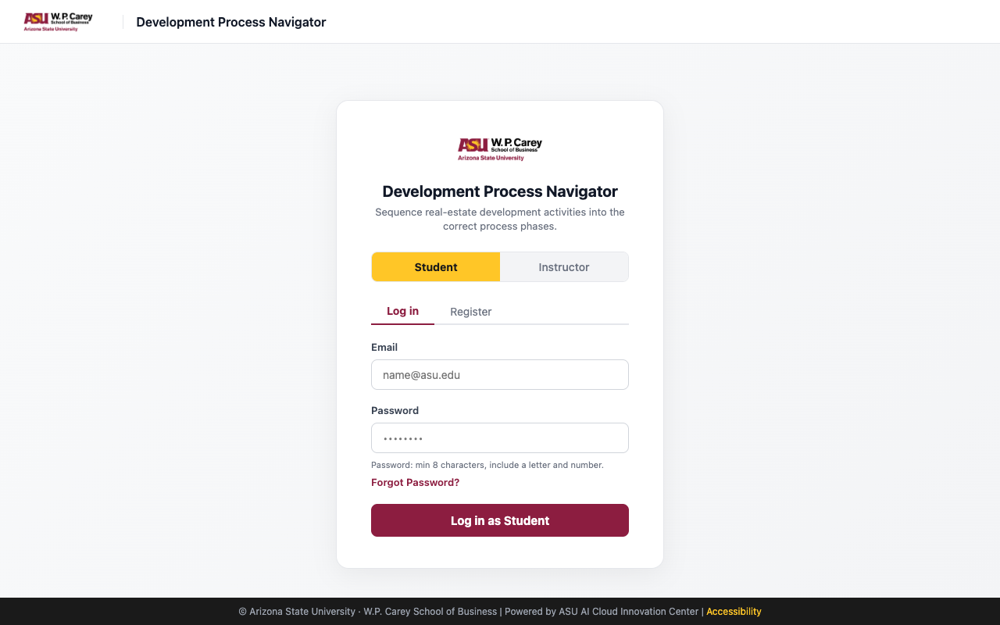
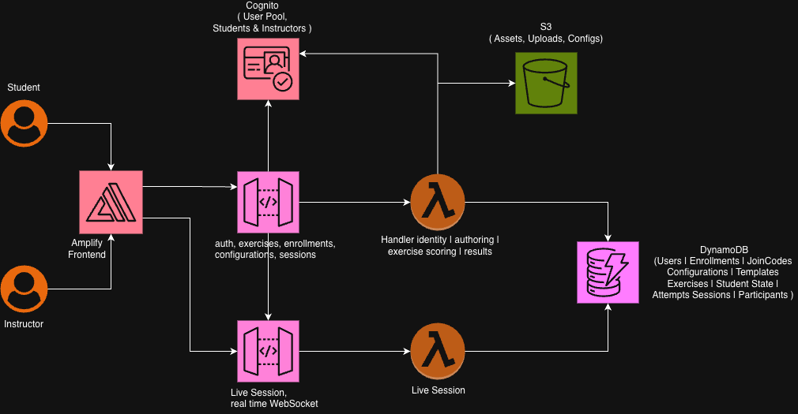

**Project Completion Documentation**

Development Process Navigator

W. P. Carey School of Business — Real Estate Program (MRED), Arizona State University

**Authors:**

**Sreeram Saravana Prasad, Lahari Shakthi Arun**

**Project Closure Date:**

**To be confirmed** (draft prepared 1 November 2026)

###

**Table of Contents**

**1[. Executive Summary](#1-executive-summary)**

**2[. Project Overview](#2-project-overview)**

2[.1 AWS Leads](#21-aws-leads)

2[.2 ASU Build Team](#22-asu-build-team)

2[.3 Project Timeline](#23-project-timeline)

2[.4 Project Timeline and Sprints](#24-project-timeline-and-sprints)

[**3\. Project Performance**](#3-project-performance)

[3.1 Problem Statement](#31-problem-statement)

[3.2 Project Scope](#32-project-scope)

[3.3 Deliverables](#33-deliverables)

[**4\. Development**](#4-development)

[4.1 UI/UX](#41-uiux)

[4.2 System Architecture](#42-system-architecture)

[4.3 Technology Stack](#43-technology-stack)

[4.4 Key Features Implementation](#44-key-features-implementation)

[4.5 Deployment](#45-deployment)

[**5\. Challenges**](#5-challenges)

[**6\. Future Scope**](#6-future-scope)

[**7\. Appendix**](#7-appendix)

###

### **1\. Executive Summary** {#1-executive-summary}

---

The Real Estate Program at the W. P. Carey School of Business teaches Master of Real Estate Development (MRED) students how complex development projects unfold. It does this through an in-person exercise: students sort physical note cards for process stages, major activities, professionals, deliverables, and decisions into the order and roles a real project follows. The exercise works well but is hard to scale, repeat, or assess. Every session takes significant instructor time, and there was no consistent way to measure how well students understood the process.

Following a Discovery Workshop with the ASU AI Cloud Innovation Center (CIC) on 15 June 2026, the team built **Development Process Navigator**, a serverless web application on AWS that digitizes the exercise.

**What instructors can do:**
- Choose one of five development scenarios from the program's Instructor Manual: Land Speculation, Master-Planned Community, Finished Lots to Homebuilders, Multi-Tenant Retail, and Residential Condominium.
- Customize the scenario's answer key and publish it as an exercise.
- Enroll students by email invite or join code.

**What students do:**
- Work through a five-round card sort:
  1. Sequence the stages.
  2. Place the major activities.
  3. Match the professionals.
  4. Match tasks and deliverables.
  5. Match developer decisions (optional).
- Finish with a budget and schedule step.
- Get an immediate weighted score with feedback for each round and a reflection prompt, then make one revision and resubmit.

Instructors see each student's attempt-to-attempt improvement and can export results.

**Benefits delivered:**
- **Repeatable**: the exercise can run across cohorts and scenarios.
- **Less instructor effort**: setup and grading take much less time, and scoring is automatic and consistent.
- **Measurable learning**: scores and improvement between attempts are recorded.
- **Low cost**: the application runs entirely on pay-per-use AWS services.

The POC scope called for AI-assisted feedback. The delivered scoring is **deterministic and rule-based** instead, driven by the Instructor Manual's reference matrix. This keeps grading transparent and repeatable, and AI-generated feedback remains a [future enhancement](#6-future-scope).

###

### **2\. Project Overview** {#2-project-overview}

---

#### **2.1 AWS Leads** {#21-aws-leads}

*To be completed by the project team.*

- *Name* – Solution Architect
- *Name* – Digital Innovation Lead
- *Name* – Project Manager

#### **2.2 ASU Build Team** {#22-asu-build-team}

- Sreeram Saravana Prasad – Developer
- Lahari Shakthi Arun – Developer

*Faculty sponsor and subject-matter lead (Real Estate Program): to be completed by the project team.*

#### **2.3 Project Timeline** {#23-project-timeline}

15-June-26 (Discovery Workshop) – 1-November-26 (latest release)

#### **2.4 Project Timeline and Sprints** {#24-project-timeline-and-sprints}

Milestones below come from the Discovery Workshop readout and the repository's commit history.

| Item # | Iterations | Deliverables | Date planned |
| :---- | :---- | :---- | :---- |
| **1** | **Pre POC** | Discovery Workshop; POC scope, objectives, and success metrics agreed | **15-Jun-26** |
| **2** | **Iteration 1** | Serverless foundation (CDK, Cognito, DynamoDB, Lambda, API Gateway, Amplify). Login and roles, drag-and-drop exercise board, ASU-branded layout, instructor and student dashboards, history and scores | **15–19-Jun-26** |
| **3** | **Iteration 2** | 26-activity template, roster and join codes, instructor access code, role-based access control, Help Center and info icons, architecture diagram | **25-Jun – 2-Jul-26** |
| **4** | **Iteration 3** | Assign flow with Exercise ID, custom phases, one-command `deploy.sh` (CloudShell-ready), SES email invites with auto-enrollment, first documentation set; live-session feature removed | **22-Jul – 14-Aug-26** |
| **5** | **Iteration 4** | Redesign to the Instructor Manual model: development-process taxonomy, five scenario templates, five-round board, budget and schedule step, scenario customizer, round-level review page | **2–10-Sep-26** |
| **6** | **Iteration 5** | Round 3 roles reusable across activities, description pop-ups on every stage and activity, collapsed-sidebar fix, access code moved out of source control, CIC documentation set | **1-Nov-26** |

###

### **3\. Project Performance** {#3-project-performance}

---

###

#### **3.1 Problem Statement** {#31-problem-statement}

Real estate development education requires students to understand tightly connected systems: timelines, stakeholders, regulations, budgets, negotiations, sequencing, and changing business conditions. The program taught this through a facilitated, in-person card exercise, which had several limits:

- **Hard to simulate real-world complexity**: it was difficult to show how a project changes across development phases and scenarios.
- **Limited scale**: the physical workshop depends on room, materials, and an instructor at every table.
- **Hard to measure**: there was no consistent way to assess students' decision-making and understanding of the process.
- **High instructor effort**: running and grading each session took significant time.
- **Limited repeatability**: the exercise was hard to repeat across cohorts and scenarios.

Every development project has its own variables, such as municipal requirements, property conditions, financing, and stakeholder priorities. The program needed a digital environment where students could practice development workflows repeatedly, with structured guidance and measurable feedback.

#### **3.2 Project Scope** {#32-project-scope}

##### **In Scope**

From the Discovery Workshop readout. The status of each item is shown.

| Scope item | Status |
|---|---|
| Interactive drag-and-drop student workspace | ✅ Delivered (five-round board) |
| Instructor authoring: scenario creation, phase configuration, activity and stakeholder definition, evaluation settings | ✅ Delivered (five scenarios + weight-matrix customizer) |
| Student workflows: participation, draft saving, submission and revision, progress tracking, guided reflection | ✅ Delivered |
| Simulation: multi-phase organization, activity placement, role mapping, budget and schedule, process visualization | ✅ Delivered |
| Classroom: individual participation, historical tracking, assessment support | ✅ Delivered (roster, results, CSV export) |
| Classroom: live classroom support | ⚠️ Prototyped, then removed (the Exercise ID and roster already met the need); team participation not built |
| AI-supported validation, guidance, feedback, and progress analysis | ⚠️ Replaced by deterministic weighted scoring and reflection prompts; AI feedback deferred |
| Serverless cloud deployment; instructor and student web applications | ✅ Delivered |

##### **Out of Scope**

- Canvas gradebook integration (future enhancement)
- Enterprise SSO during initial deployment
- Replacing commercial project management software
- General-purpose PM certification training
- Native mobile application development
- Full institutional LMS integrations
- Licensing and commercialization models

#### **3.3 Deliverables** {#33-deliverables}

* Functional educational web application (Next.js on AWS Amplify)
* Student and instructor portals with role-based access
* Interactive card-based exercise: five rounds plus budget and schedule, with five scenario templates
* Submission and scoring engine (weighted, deterministic, unit-tested) with one resubmission
* Results and history tracking with CSV export
* Roster management: email invites through Amazon SES and join codes
* Infrastructure as code (AWS CDK) and a one-command deploy script
* Branding to ASU and W. P. Carey guidelines
* Documentation: [User Guide](./userGuide.md), [Deployment Guide](./deploymentGuide.md), [API Documentation](./APIDoc.md), [Architecture Deep Dive](./architectureDeepDive.md), and [Modification Guide](./modificationGuide.md)
* Source code and configuration files ([GitHub](https://github.com/ASUCICREPO/Development-Process-Navigator))

###

### **4\. Development** {#4-development}

---

####

#### **4.1 UI/UX** {#41-uiux}

---

#### **Who are the users of this application?**

- **Students**: graduate students in the MRED program, many with industry experience, learning how development projects are sequenced and staffed.
- **Instructors**: Real Estate Program faculty who run the exercise in class and assess it.

#### **Why are the users using this application?**

- **Students** use it to practice structuring a development project from start to finish: which stages come first, which activities sit in each stage, who contributes, and what gets decided. They get instant, specific feedback and a second attempt to improve.
- **Instructors** use it to run the exercise for a whole class with less setup. They can pick the scenario that fits the day's lesson and see how the class did and improved, without grading by hand.

#### **What is the customer opportunity statement?**

How might we turn a valued, hands-on card exercise into a scalable digital experience that keeps its realism and discussion value, while adding repeatable scenarios, immediate feedback, and measurable learning outcomes?

#### **User Interface**

> Role-aware sign-in. Students and instructors register separately, and instructor accounts need an access code.

*Additional screenshots to add (from a signed-in session): student dashboard, a Round 3 board showing a professional placed in several activities with the ⓘ description pop-up, the results screen, the instructor scenario customizer, and the class results table.*

####

#### **4.2 System Architecture** {#42-system-architecture}

The application is fully serverless and defined in one AWS CDK stack:

- **Frontend**: a static Next.js frontend on AWS Amplify.
- **API**: Amazon API Gateway, protected by an Amazon Cognito authorizer, routes every request to a single Python Lambda organized as a modular monolith.
- **Data**: twelve on-demand Amazon DynamoDB tables.
- **Email**: Amazon SES sends roster invites.

##### **Architecture Diagram**

##### **Workflow Description**

1. **Step 1:** An instructor signs in through the Amplify-hosted site, picks a scenario, optionally adjusts its weight matrix, and publishes it. The API freezes that configuration as a version and creates an exercise.
2. **Step 2:** Students join the class with a join code or an email invite and open the exercise. The API returns the cards and targets, but never the answer weights.
3. **Step 3:** Students place cards round by round. Drafts save to DynamoDB, and every request carries a Cognito token that API Gateway checks.
4. **Step 4:** On submit, the Lambda scores each round with the scoring engine and stores the attempt. The browser shows the overall score, the per-round breakdown, and a reflection prompt.
5. **Step 5:** The student revises and resubmits once, which locks the exercise. The instructor reviews Attempt 1 against Attempt 2 for the class and exports the results.

####

#### **4.3 Technology Stack** {#43-technology-stack}

##### **Frontend**
- **Next.js 14 (React, TypeScript)**: a static export that runs only in the browser, with drag-and-drop boards, dashboards, and the Help Center
- **Hosting**: AWS Amplify Hosting

##### **Backend Services**
- **Amazon API Gateway (REST)**: the single API entry point, with a Cognito authorizer and CORS
- **AWS Lambda (Python 3.12)**: one function for every route (identity, authoring, exercise and scoring, results)
- **Amazon Cognito**: user pool with instructor and student roles
- **Amazon SES**: roster invite emails from a verified W. P. Carey domain

##### **Data Storage**
- **Amazon DynamoDB**: twelve on-demand tables (users, enrollments, configurations and versions, templates, exercises, student state, attempts, and others)
- **Amazon S3**: private asset bucket, reserved for future uploads

##### **AI/ML Services**
- **None in this release.** Scoring is deterministic and rule-based. See [Future Scope](#6-future-scope) for planned AI feedback.

##### **Infrastructure**
- **AWS CDK**: infrastructure as code for deployment (TypeScript, single stack)
- **Amazon CloudWatch Logs**: Lambda logs with one-month retention
- **`deploy.sh`**: one-command deploy that works from a laptop or AWS CloudShell

####

#### **4.4 Key Features Implementation** {#44-key-features-implementation}

##### **Feature 1: Multi-round card sort based on the Instructor Manual**
The program's taxonomy is encoded in `taxonomy.py`: 8 process stages, 15 major activities, about 30 professionals, tasks and deliverables, and developer decisions, each with weights for every activity. Five scenario templates (`seed_templates.py`) scale or remove activities to fit each development type. Round 1 is drag-to-reorder, and Rounds 2–5 are pool-to-column boards. In Round 3, professional cards stay in the pool so a role can be placed in every activity it contributes to. Every stage and activity column has an ⓘ pop-up with its description.

##### **Feature 2: Weighted, transparent scoring with one resubmission**
The scoring engine is pure Python with no I/O and is unit-tested.
- **Credit**: each card earns the sum of the weights of its placements, capped at its maximum.
- **Labels**: each placement is marked Correct, Partial, or Incorrect.
- **Sequence round**: scored by distance from the correct position.
- **Overall**: the exercise score combines the rounds, weighted by each round's maximum.

The single largest gap becomes a reflection prompt. Weights never leave the server. The first submission records attempt 1, and one resubmission records attempt 2 and locks the exercise, which gives a built-in measure of improvement.

##### **Feature 3: Instructor authoring, roster, and results**
- **Authoring**: instructors publish a scenario in one click, or adjust its reference matrix first. Publishing freezes a version, so later edits never change exercises already in progress.
- **Roster**: students enroll with a join code or an SES email invite. Unregistered invitees are enrolled automatically when they sign up.
- **Results**: the results view shows class average, highest and lowest scores, and each student's Attempt 1 → Attempt 2 change, with CSV export.

####

#### **4.5 Deployment** {#45-deployment}

The full stack deploys with a single script that works on a laptop or in AWS CloudShell. See the [Deployment Guide](./deploymentGuide.md) for details.

##### **Prerequisites**
- An AWS account with permissions for CloudFormation, Lambda, API Gateway, DynamoDB, Cognito, Amplify, SES, S3, and IAM
- AWS CLI v2, Node.js 18+, and Python 3.12+ (CloudShell already has all three)
- An instructor access code chosen by the deployer (supplied at deploy time, never committed)

##### **Deployment Steps**
1. `git clone https://github.com/ASUCICREPO/Development-Process-Navigator.git && cd Development-Process-Navigator`
2. `AWS_PROFILE=<profile> ./deploy.sh`, then enter the instructor access code when asked
3. Optionally verify the SES domain (add its DKIM records) so invite emails are delivered
4. Open the printed Amplify URL, register an instructor, and publish a scenario

###

### **5\. Challenges** {#5-challenges}

---

- **Challenge 1: Turning a physical, discussion-driven exercise into digital scoring.** Professional roles overlap on purpose, and many placements are defensible.
  - **Solution:** A 0–100 weight matrix from the Instructor Manual's reference tables gives partial credit, plus Correct, Partial, and Incorrect feedback and a reflection prompt. Round 3 lets roles go in several activities. *Open item:* because extra placements cost nothing, a student can place a role everywhere and still get full credit (see [Future Scope](#6-future-scope)).

- **Challenge 2: Mid-project redesign of the exercise model.** The first version was a single sort of 26 activities into phases. Faculty feedback pointed toward the manual's multi-round structure.
  - **Solution:** The team rebuilt the exercise on a generic card-to-target scoring core, a new taxonomy, and five scenario templates. Earlier single-sort exercises stayed readable.

- **Challenge 3: Scope that grew beyond the POC.** The scope listed live classroom support and AI functionality.
  - **Solution:** A live-session (WebSocket) feature was prototyped and then removed, because sharing an Exercise ID with an enrolled roster already met the classroom need. AI feedback was deferred in favor of transparent, deterministic scoring.

- **Challenge 4: Deploying from restricted environments.** AWS CloudShell's roughly 1 GB disk and missing named profiles broke early deploys.
  - **Solution:** `deploy.sh` makes the profile optional, runs CDK through `npx`, and clears caches and build artifacts between steps to avoid running out of disk space.

- **Challenge 5: Sending invite emails from university addresses.**
  - **Solution:** The W. P. Carey domain was verified in SES with DKIM. Invites come from a verified no-reply address with the instructor as Reply-To, and instructors' addresses are verified automatically when they register.

- **Challenge 6: Keeping the instructor gate secret.** The instructor access code was originally hard-coded in source.
  - **Solution:** The code is now supplied at deploy time. Synth fails without it, and the backend refuses instructor sign-up rather than falling back to a default. The previously committed code should be considered exposed and rotated.

###

### **6\. Future Scope** {#6-future-scope}

---

* **Scoring refinement:** penalize placements that have no weight, especially in Round 3, so that placing a role everywhere doesn't earn full credit.
* **AI-assisted feedback (Amazon Bedrock):** generate explanations for weak placements and respond to student reflections, while keeping the score itself deterministic.
* **Password reset:** the frontend flow and backend handlers exist. Add the two public API Gateway routes to turn it on.
* **Team participation and live classroom mode:** shared boards for groups and a live progress view for instructors. The WebSocket API and tables are still provisioned and can be reused or removed.
* **Integrations:** Canvas gradebook export or LTI, and ASU SSO (out of scope for this POC).
* **Operational hardening:**
  - Restrict CORS to the app's domain.
  - Replace DynamoDB scans with GSI queries.
  - Retain production tables instead of deleting them on teardown.
  - Connect Amplify to the repository for CI/CD.
  - Refresh the outdated smoke-test script.
* **Content:** more scenarios and instructor-authored templates shared across sections.

####

### **7\. Appendix** {#7-appendix}

---

**GitHub Repository** - https://github.com/ASUCICREPO/Development-Process-Navigator

**Figma Link (Internal)** - For the currently implemented version - *to be added by the project team*

**Project Demo Recording** - *to be added by the project team*

**Drive Link** - *to be added by the project team*

**Additional resources:**

**[User Guide](./userGuide.md) · [Deployment Guide](./deploymentGuide.md) · [API Documentation](./APIDoc.md) · [Architecture Deep Dive](./architectureDeepDive.md) · [Modification Guide](./modificationGuide.md)**

**Discovery Workshop Readout — "Real Estate Program (Dev Process Navigator) Scope" (repository root, PDF)**

**Instructor Manual — Real Estate Development Process Digital Card-Sorting Exercise (downloadable from the in-app Help Center)**
