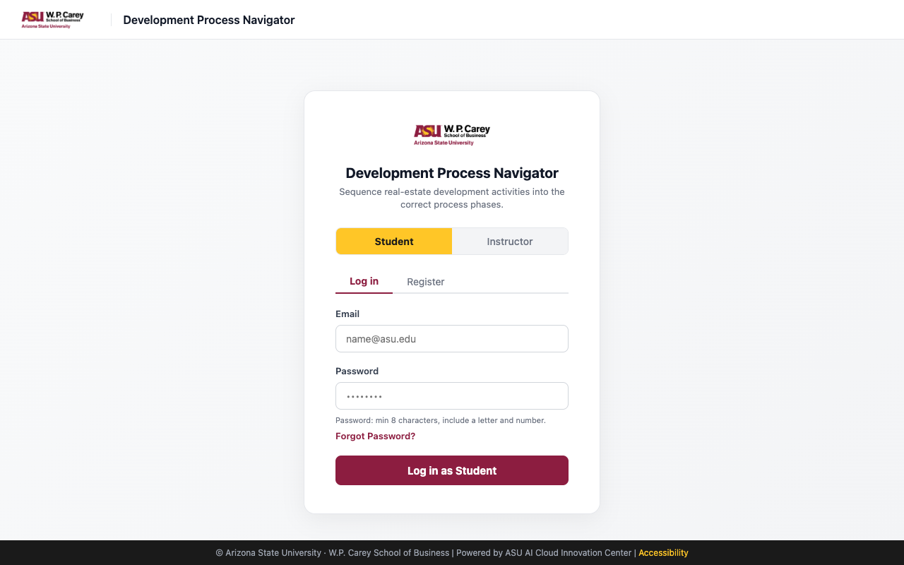

# User Guide

This guide walks you through using Development Process Navigator as an instructor or a student.

---

## Prerequisites

**The application must be deployed before you start.**

See the [Deployment Guide](./deploymentGuide.md) for deployment instructions. To register as an instructor, you'll also need the **instructor access code** your administrator chose at deploy time.

---

## Introduction

Development Process Navigator is a digital card-sorting exercise for ASU W.P. Carey's Master of Real Estate Development (MRED) program. It replaces the paper note-card exercise from the Instructor Manual.

Students learn how a real estate development project unfolds: the process stages, the major activities in each stage, the professionals who contribute, the deliverables they produce, and the decisions a developer makes along the way. Instructors pick a development scenario, publish it as an exercise, and review how the class did.

Students work through up to five rounds of cards and a Budget & Schedule step. They get a weighted score with feedback for each round, then one chance to revise and resubmit.

### Key Features
- **Five scenarios from the Instructor Manual**: Land Speculation, Master-Planned Community, Finished Lots to Homebuilders, Multi-Tenant Retail, and Residential Condominium.
- **Multi-round card sort**:
  - Sequence the 8 process stages.
  - Place the major activities onto stages.
  - Match professionals, tasks/deliverables, and developer decisions to activities.
  - Professionals can go in more than one activity.
- **Help on every column**: an ⓘ icon on each stage and activity column explains what it covers.
- **Partial credit**: overlapping answers earn partial credit, and a reflection prompt points to your weakest placement.
- **Two attempts**: submit, review the feedback, then make one final resubmission.
- **Instructor tools**: class roster (email invite or join code), class results with attempt-by-attempt changes, and CSV export.

---

## Getting Started

### Step 1: Access the Application

Go to your deployment's URL, which looks like `https://main.<app-id>.amplifyapp.com`.

- Choose **Student** or **Instructor** at the top of the card. The button label changes to match (for example, **Log in as Student**).
- Use the **Log in** tab if you already have an account, or **Register** to create one.
- Passwords need at least 8 characters, including a letter and a number.

---

### Step 2: Create an Account

1. Choose your role, then open the **Register** tab.
2. Enter your **Email**, **Password**, and **Display Name**.
3. Fill in the extra field for your role:
   - **Students**: optionally enter the **Join Code** your instructor gave you (for example `ASU-1A2B`). This enrolls you in their class right away. If your instructor invited you by email, you're enrolled automatically when you register with that address.
   - **Instructors**: enter the **Instructor Access Code**. Instructor accounts are restricted, so ask your department administrator for the code.
4. Submit the form. You'll be taken to your dashboard.

---

### Step 3: Instructor — Publish an Exercise

1. In the sidebar, go to **My Exercises**. The **How to set up an assignment** panel summarizes these steps.
2. Under **Create New Exercise**, pick a **Scenario / Template** (for example, *Scenario D — Multi-Tenant Retail*). Optionally give it an **Exercise Name**.
3. Click **Create & Publish**. You'll see **✓ Exercise published** and the **Exercise ID**.
4. To change the answer key first, use **Customize a Scenario** instead:
   1. Choose a scenario to customize.
   2. Adjust the reference matrix. Each card gets a weight from 0 to 100 for each target; 100 is the primary answer.
   3. Click **Save Draft** to keep working later, or **Save & Publish Exercise**.

- Publishing freezes that version. If you edit the scenario later, the exercise students are already working on doesn't change.
- On the **Dashboard**, click **Assign** on an exercise to see its Exercise ID and how students can open it.

---

### Step 4: Instructor — Enroll Students

1. Go to **Student Roster** and click **+ Add Student**.
2. Choose one of two methods:
   - **By Email Invite**: enter the student's email and click **Send Invite**. Registered students are added right away. Unregistered students get an invite email and are enrolled when they sign up.
   - **By Join Code**: click **📋 Copy Code** and share it. **↻ Regenerate** creates a new code.
3. Enrolled students see your published exercises on their dashboard automatically.

- Use the search box to find a student, **View** for their exercise history, and **📥 Export CSV** to download the roster.

---

### Step 5: Student — Complete the Exercise

1. On **My Dashboard**, open an exercise from **My Exercises**. You can also go to **Current Exercise** and enter the Exercise ID under **Load an Exercise**.
2. The header shows your progress: one numbered dot per round, plus **$** for Budget & Schedule.
3. Work through each round:

   | Round | What you do |
   |---|---|
   | **1 — Sequence the Process** | Drag the 8 stage cards into order. Drop a card onto another card to swap positions. Each card is scored by how close it is to its correct position. |
   | **2 — Place the Major Activities** | Drag each activity from the left pool into the stage column where it mainly belongs. |
   | **3 — Match the Professionals** | Drag each professional into every activity they contribute to. **Cards stay in the pool**, so you can use the same role (for example, Civil Engineer) in several activities. A **×N** badge shows how many activities a card is in. |
   | **4 — Match Tasks & Deliverables** | Match each task or deliverable to its activity. |
   | **5 — Developer Decisions** (optional) | Match each go/no-go decision to the activity it follows, or click **Skip to Budget & Schedule**. |

4. Click the **ⓘ** on any column header for that stage or activity's description. Hovering shows a quick preview; clicking keeps it open until you click **×**, click somewhere else, or press Esc.
5. To move a card, drag it to another column. To remove it, click **×** on the card or drag it back to the pool.
6. Click **Next →** once every card in the round is placed (optional rounds can be skipped). **← Back** returns to an earlier round, and **Save Draft** saves your progress.

---

### Step 6: Student — Budget & Schedule, Submit, and Review

1. On the **Budget & Schedule** step, choose a **Cost Category** for each major activity (Acquisition, Soft, Hard, Financing, Operating, or Selling/Leasing Cost) and enter a rough **Duration (days)**.
2. Click **Submit Exercise**.
3. The results screen shows:
   - Your **Overall Score**.
   - A **Round breakdown** with a percentage for each round.
   - A **Reflection** prompt about your weakest match.
4. Click **Revise & Resubmit** to adjust your placements, then **Resubmit (final)**. Your second submission is final and locks the exercise.
5. Later, open **My History** to see every attempt with its score, status, and date. Each attempt's detail view shows every card, where you placed it, and the best answer. **My Scores** shows your average score, personal best, and number of exercises completed.

---

### Step 7: Instructor — Review Results

1. Go to **Results & History** and select an exercise.
2. Review the **Class Average**, **Highest Score**, and **Lowest Score**, plus a table with each student's **Attempt 1**, **Attempt 2**, **Change**, and **Status**.
3. Filter by status (All, Completed, Submitted, In Progress, or Not Started) or by date.
4. Click **📥 Download Report** to export a CSV for your gradebook.

---

## Common Use Cases

### Use Case 1: Run the exercise in a class session

The instructor publishes one scenario, and the whole class completes it during the session.

**Steps:**
1. Before class, publish the scenario that matches the lesson. For example, use *Scenario B — Master-Planned Community* for entitlements and phasing.
2. Show the roster **Join Code** at the start of class so students can register and enroll.
3. Students complete the rounds and submit. Discuss the **Round breakdown** and the reflection prompts together.
4. Give students a few minutes to **Revise & Resubmit**, then review the **Attempt 1 → Attempt 2** change in **Results & History**.

---

### Use Case 2: Adjust the answer key for a teaching focus

The instructor wants to stress a different set of answers than the manual's default matrix.

**Steps:**
1. Go to **My Exercises** → **Customize a Scenario** and choose the scenario.
2. In the reference matrix, raise or lower the weights for the cards you want to emphasize. For example, give the Traffic Engineer more weight under Zoning, Entitlements & Public Approvals.
3. Click **Save & Publish Exercise** and share the new Exercise ID.

---

## Tips and Best Practices

- **Use the ⓘ icons**: in Rounds 2–5, each column's description is the quickest way to decide where a card belongs.
- **Use roles more than once**: in Round 3, real projects overlap. A Civil Engineer contributes to design, entitlements, and construction, so place each professional everywhere they actually contribute.
- **Save often**: **Save Draft** keeps your placements if you close the tab, and they load again when you return.
- **Read your feedback before resubmitting**: you only get one resubmission. Use the breakdown and reflection prompt to focus your changes.
- **Instructors**: enroll students *before* sharing the exercise, so it shows up on their dashboard without needing the ID.

---

## Frequently Asked Questions (FAQ)

### Q: Why is the Next button greyed out?
**A:** Every card in a required round must be placed in at least one column. In Rounds 2, 4, and 5, the pool counter shows how many cards are left. In Round 3, the counter shows roles that haven't been placed anywhere yet.

### Q: Can I change my answers after submitting?
**A:** Yes, once. After your first submission, click **Revise & Resubmit**, make your changes, and click **Resubmit (final)**. After that, the exercise is locked.

### Q: I don't see any exercises on my dashboard.
**A:** You're probably not enrolled yet. Ask your instructor for a join code or an email invite, or enter the Exercise ID under **Current Exercise** → **Load an Exercise**.

### Q: How is my score calculated?
**A:** Each card has a weight from 0 to 100 for each possible answer, and the best answer is 100. A card earns the weight of the answers you chose, capped at its maximum. Placements are marked Correct (best answer), Partial (a reasonable answer), or Incorrect. Round 1 is scored by how close each stage is to its correct position. Your overall score combines all rounds.

---

## Troubleshooting

### Issue: "Invalid instructor access code"
**Solution:** Check the code with your department administrator. The code is case-insensitive. If the message says instructor registration is "not configured", the deployment has no code set and an administrator needs to redeploy with one.

### Issue: Forgot Password doesn't work
**Solution:** Password reset isn't available in the current deployment. Ask an administrator to reset your password for you.

### Issue: "Session expired. Please log in again."
**Solution:** Your sign-in token expired. Log out, log back in, and reopen the exercise. Your saved draft loads automatically.

### Issue: Pages load but show no data, or show "is not valid JSON"
**Solution:** The site was built without its API address. This is a deployment issue, so contact whoever deployed the app (see the [Deployment Guide](./deploymentGuide.md#troubleshooting)).

---

## Getting Help

If you run into something this guide doesn't cover:

- Open **Help** in the sidebar (Help Center). It has role-specific guides and a downloadable **Instructor Manual**.
- Students: contact your instructor.
- Open an issue on the [GitHub repository](https://github.com/ASUCICREPO/Development-Process-Navigator/issues), or reach out to the ASU AI Cloud Innovation Center team.

---

## Next Steps

- See the [API Documentation](./APIDoc.md) for programmatic access.
- Read the [Architecture Deep Dive](./architectureDeepDive.md) to understand how the system works.
- See the [Modification Guide](./modificationGuide.md) if you want to customize the application.
